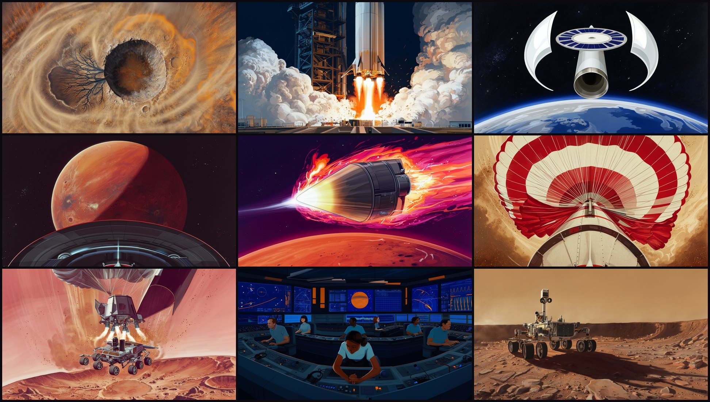
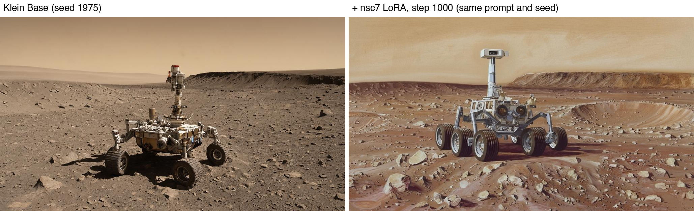

# Perseverance — Earth to Mars, painted like it's 1975

A 2 min 12 s short film about the Mars 2020 mission, told in the style of NASA's 1970s concept art. Every frame starts as a keyframe from **FLUX 3 Image Klein** with a custom style LoRA, and is brought to life by the **FLUX 3 video** model.

Built for the [BFL FLUX 3 challenge](docs/challenge.md): teach Klein a style it doesn't have, then make a film with it.



## The style: `nsc7 style`

Klein knows "space art", but not *this* space art: the hand-painted gouache and acrylic paintings Rick Guidice made for NASA Ames between 1972 and 1978. Airbrushed gradients, saturated violet, magenta and orange skies, crisp hardware against brushy backgrounds.

Same prompt, same seed. Klein Base on the left, with the LoRA on the right:



**LoRA:** [huggingface.co/kocabiyik/nsc7-style-lora](https://huggingface.co/kocabiyik/nsc7-style-lora)

| | |
|---|---|
| Data | 22 public-domain paintings by one artist, from [images.nasa.gov](https://images.nasa.gov/) |
| Cleaning | mats and borders cropped, painted signatures removed with FLUX Erase, near-duplicates dropped |
| Captions | content only (never the look), ending in `nsc7 style` |
| Training | Klein Base, AI Toolkit, rank 32, lr 1e-4, 1024 px, one RTX PRO 6000 |
| Checkpoint | step 1000 of 2000: full style by 1000, subjects started copying the training set by 1250 |

## The film

18 shots in five acts, following the real mission timeline:

1. **The Question** — Mars once had water. Was anything alive?
2. **Liftoff** — Atlas V, Cape Canaveral, July 30, 2020.
3. **The Long Dark** — seven months, 470 million km.
4. **Seven Minutes of Terror** — entry, parachute at Mach 1.7, sky crane.
5. **Touchdown Confirmed** — February 18, 2021, Jezero Crater.

How it holds together:

- **One look in motion.** The video model never sees the LoRA, so every motion prompt ends by naming the medium and saying it holds: *"it stays a flat hand-painted 1970s gouache space painting."*
- **One rover.** The hero rover is generated once; the sky-crane start and end frames are Klein edits of it, so it is the same machine from descent to landing.
- **Cut for action.** Keyframes start mid-action, motion prompts are written in timed phases with named camera moves, each clip carries its own generated sound, and the cut adds camera shake and a 7:00 → 0:00 entry HUD.

Shot lists: [v1, 8 shots](docs/shots.md) · [v2, 18 shots](docs/shots_v2.md) · [original Blender breakdown](docs/clips.md)

## Pipeline

```
fetch_space_colony.py   images.nasa.gov  ->  data/space_colony/raw/
prep_space_colony.py    drop rejects, crop mats, resize  ->  data/space_colony/train/
erase_signatures.py     FLUX Erase on painted signatures
training/               AI Toolkit config + GPU setup script
base_check.py           can Klein already do it? (it can't)
keyframes.py            Klein + LoRA  ->  out/v2/keyframes/
video.py                FLUX 3 video drafts, then draft_enhance to 1080p
cut_v2.py               ffmpeg cut: crossfades, shake, HUD, captions, sound
```

Shots are defined once in [`pipeline/shots_v2.py`](pipeline/shots_v2.py) and shared by the keyframe, video and cut steps.

### Run it

Put your BFL key in `.env` as `API_KEY=...`. Keyframes run on a CUDA GPU (diffusers from `main`); everything else runs on a laptop with `ffmpeg` and Pillow.

```bash
# GPU box
python pipeline/keyframes.py --v2 --model base --scale 1.0 --lora nsc7-style-lora_000001000.safetensors

# Laptop
python pipeline/video.py --v2                  # 18 drafts with audio
python pipeline/video.py --v2 --only 4b_chute  # redo one
python pipeline/cut_v2.py --drafts             # preview cut
python pipeline/video.py --v2 --final          # 1080p
python pipeline/cut_v2.py                      # out/v2/film.mp4
```

## Repository

```
pipeline/   dataset, keyframe, video and cut scripts
training/   LoRA training config and GPU setup
data/       the 22 training images and their captions
docs/       challenge brief, shot lists, README images
blender/    an earlier all-Blender version of the film (scenes, build scripts, renders)
out/        generated keyframes, training samples, submission assets (mostly git-ignored)
```

## Credits

Training images: NASA Ames Research Center, artwork by Rick Guidice, public domain. Models: FLUX 3 Image Klein and FLUX 3 video by Black Forest Labs.
